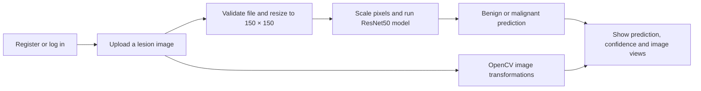

<div align="center">

# Skin Cancer Detection

### Skin lesion image classification with ResNet50, TensorFlow and Flask

An educational computer-vision project that classifies an uploaded skin-lesion image as **benign** or **malignant** and displays image-processing views alongside the model confidence.

[](https://www.python.org/)
[](https://flask.palletsprojects.com/)
[](https://www.tensorflow.org/)
[](https://keras.io/)
[](https://opencv.org/)
[](https://www.sqlite.org/)

**Author:** Pragya · **Role:** Machine Learning & Computer Vision Developer

</div>

---

## Problem Statement

Skin lesions can look similar to the untrained eye. This project explores how a convolutional neural network can learn visual patterns from labelled lesion images and return a two-class prediction through a simple web interface. It also demonstrates a complete, small-scale machine-learning workflow: image preparation, model inference, web upload handling, and result presentation.

> **Educational use only.** This project is not a medical device and must not be used to diagnose, screen, or choose treatment for skin cancer. A model prediction or confidence score is not a substitute for assessment by a qualified clinician.

## Key Highlights

- ResNet50-based transfer-learning classifier for **benign** and **malignant** labels.
- Flask web interface with user registration and login backed by SQLite.
- Upload validation for JPEG, PNG, BMP and WebP images, with a 10 MB request limit.
- OpenCV views of the uploaded image: grayscale, edge detection, thresholding and sharpening.
- Password hashing, parameterized SQL queries, protected result/graph pages, and a configurable Flask session secret.
- Training script creates a reproducible 80/20 training/validation split and saves accuracy/loss plots.

## Workflow



## Tech Stack & Tools

| Area | Technologies |
|---|---|
| Language |  |
| Web application |  · HTML · CSS · Bootstrap · JavaScript · jQuery |
| Deep learning |  ·  · ResNet50 |
| Image processing |  · Pillow · NumPy |
| Data and evaluation |  · scikit-learn · Matplotlib |
| Development |  ·  · `venv` · `pip` |

## Project Structure

```text
skin_cancer_detection/
├── app.py                 # Flask application, authentication and inference
├── RESNET_50_TRAIN.py     # Model training, validation and evaluation
├── requirements.txt       # Python dependencies
├── .env.example           # Optional local Flask secret configuration
├── class_names.pkl        # Class labels used by the saved model
├── ResNet50_model.h5      # Local model file; intentionally not committed
├── user_data.db           # Local SQLite database; created at first run
├── train/
│   ├── benign/            # Local labelled training images (not committed)
│   └── malignant/
├── test/                  # Optional held-out class folders (not committed)
├── templates/             # Flask/Jinja pages
└── static/                # CSS, JavaScript, web assets and generated outputs
```

The checked-in repository intentionally excludes the image datasets, saved model, local database, uploads and generated training artifacts. The current local project has **5,000 benign** and **4,605 malignant** images under `train/`. There are **36 images** in `test/`, but they are stored flat in that folder rather than in `test/benign/` and `test/malignant/` class subfolders. The training script therefore uses a validation split and does not report a held-out test score for the current layout.

## Getting Started

### Requirements

- Python **3.9–3.11**
- `pip` and a virtual environment
- A compatible ResNet50 model file and the matching `class_names.pkl` to run inference
- Labelled training images if you need to train or regenerate the model

### 1. Clone and install

```bash
git clone https://github.com/pragya0405/skin_cancer_detection.git
cd skin_cancer_detection
python3 -m venv .venv
source .venv/bin/activate        # Windows: .venv\Scripts\activate
python -m pip install --upgrade pip
python -m pip install -r requirements.txt
```

### 2. Add local model and data files

The Flask app expects `ResNet50_model.h5` in the project root and the matching `class_names.pkl` beside it. The model is about **390 MiB**, above GitHub's regular Git file limit, so it is excluded from this repository. Obtain it from your trusted project backup or train a replacement as described below. Do not use a model unless you know its source and class order.

For training, arrange labelled images like this:

```text
train/
├── benign/
│   └── image files...
└── malignant/
    └── image files...
```

### 3. Configure the optional `.env`

`.env` is optional for local use. Without it, the app creates a random session secret each time it starts, which signs users out after a restart. For a stable local secret, copy the example file and replace the placeholder with a fresh random value:

```bash
cp .env.example .env
python -c "import secrets; print(secrets.token_hex(32))"
```

Put the generated value after `FLASK_SECRET_KEY=` in `.env`. **Never commit `.env` or share its contents.**

### 4. Train a model (optional)

With the labelled `train/` folders in place and the virtual environment activated:

```bash
python RESNET_50_TRAIN.py
```

The script uses an 80/20 split of `train/`, starts from ResNet50 ImageNet weights (downloaded on first use), trains for 10 epochs, and writes `ResNet50_model.h5`, `class_names.pkl`, and accuracy/loss plots. Training time depends on the computer and available acceleration. If `test/` contains matching class subfolders (`benign/` and `malignant/`) with labelled images, the script also reports held-out test accuracy; the 36 supplied test images are flat and are not used for that metric.

### 5. Start the web app

```bash
python app.py
```

Open <http://127.0.0.1:5000>, register an account, sign in, and choose an image to analyse. The upload must be a readable JPG/JPEG, PNG, BMP or WebP image no larger than 10 MB.

## Expected Output

After an image is accepted, the results page shows:

1. The model's **benign** or **malignant** class prediction and its confidence percentage.
2. The uploaded image and four OpenCV transformations: grayscale, edges, threshold and sharpened image.
3. A reminder that model results do not replace clinical assessment.

After training, the graph page can show the generated training and validation accuracy/loss plots.

## Configuration & Privacy

- `FLASK_SECRET_KEY` is the only application setting; it can be supplied in `.env` or the process environment. Other external services and API tokens are not used.
- `user_data.db`, uploaded images, datasets, model weights and generated plots are local files and are excluded from Git.
- Use only image data you are authorized to process. Avoid exposing this development server to the public internet.
- The original `acc.txt` value is not presented as a verified model score: the supplied flat `test/` images are not connected to the evaluation flow.

## License

The project source code is available under the [MIT License](LICENSE). Dataset, pretrained weights, fonts, templates, and other third-party assets may have separate terms; verify their licenses before redistribution.

## Author

**Pragya** · Machine Learning & Computer Vision Developer

[](https://www.linkedin.com/in/pragya0405/)
[](mailto:pragya.p0405@gmail.com)

---

If you find this project useful for learning, feel free to star the repository or connect with me on LinkedIn.
